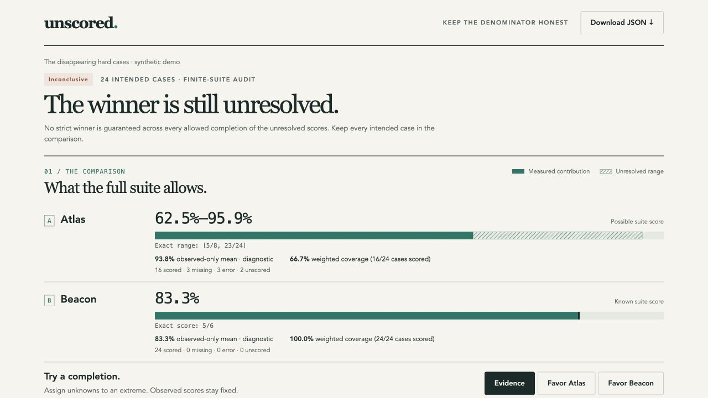

# Unscored

**Could the missing evaluation results change your winner?**

Unscored checks an incomplete evaluation against the cases you intended to run. It computes exact possible score ranges, shows hypothetical completions that change the winner, and exports the unresolved cases to measure next.

Local files in. A portable report out. No API keys, model calls, server, telemetry, or runtime dependencies. **MIT licensed · Python 3.10+ · Alpha 0.1.0**

[Open the interactive synthetic demo](https://riyadmehdi7.github.io/unscored-eval/) · [Read the idea research](docs/RESEARCH.md)



## The problem in 20 seconds

Your dashboard says Atlas beats Beacon. But Atlas's hard cases failed to produce scores:

| System | Observed-only mean | Scored cases | Possible full-suite score |
|---|---:|---:|---:|
| Atlas | 93.75% | 16 / 24 | 62.50–95.84% |
| Beacon | 83.33% | 24 / 24 | 83.33% (exactly 5/6) |

Atlas has 15 successes among 16 measured cases, with 8 unresolved. Beacon has 20 successes among 24. If Atlas's missing outcomes are all zero, Beacon wins; if all one, Atlas wins. **The comparison is inconclusive.** The display above rounds interval endpoints outward; exact bounds are 15/24–23/24 and the fixed point 20/24.

This is a synthetic demonstration, not a claim about real models. Denominator-drop failures have been [reported in real evaluation software](https://github.com/EleutherAI/lm-evaluation-harness/issues/4062).

## Try it

Clone the source, then run the bundled example:

```sh
git clone https://github.com/RiyadMehdi7/unscored-eval.git
cd unscored-eval
python3 -m venv .venv
. .venv/bin/activate
python -m pip install .
unscored demo --out demo
```

Open `demo/report.html` in a browser. It works offline and can be shared as one file. The same directory contains `report.json` with exact rational values and `rerun.csv` with unresolved measurements. Use a new output directory for each run; existing files are never intentionally overwritten.

You can also run directly from source without installation:

```sh
PYTHONPATH=src python3 -m unscored demo --out demo
```

The distribution name is `unscored-eval`; the Python module and executable are `unscored`. Installation instructions use this source repository; no PyPI publication is implied.

## Audit your evaluation

Declare the intended population **before filtering failed results**. A suite has exactly two systems, unique case IDs, and optional positive weights and groups:

```json
{
  "version": 1,
  "name": "Support-agent comparison",
  "systems": ["current", "candidate"],
  "cases": [
    {"id": "refund", "group": "policy"},
    {"id": "escalation", "group": "policy", "weight": 2}
  ]
}
```

Write one canonical result per system/case to `results.jsonl`. Scores are numeric, higher-is-better, and between 0 and 1:

```jsonl
{"system":"current","case_id":"refund","status":"scored","score":1}
{"system":"current","case_id":"escalation","status":"scored","score":0.5}
{"system":"candidate","case_id":"refund","status":"scored","score":1}
{"system":"candidate","case_id":"escalation","status":"error"}
```

```sh
unscored audit suite.json results.jsonl --out audit
```

- `scored`: requires a numeric `score` in [0, 1], including zero.
- `error` or `unscored`: forbids a score and remains unresolved.
- Absent record: counted as `missing`, with the intended case still in the denominator.
- Duplicate pair, unknown ID, extra/misspelled field, duplicate JSON key or invalid number: rejected. Retries must be reduced according to an explicit policy before export; Unscored never silently keeps the best or last attempt.

If your protocol defines a timeout as a failure, encode it as `scored` with score 0. If the judge broke and you do not know the outcome, use `error` or `unscored`. Unscored cannot choose that policy for you. Do not construct the manifest from successful rows: it cannot discover intended cases that you omitted from both files.

For multiple metrics or epochs, audit separate exports or use explicit case IDs and justified weights. Losses must be normalized into a declared higher-is-better [0, 1] score. Mixing incomparable scores does not become meaningful because this tool can average them.

## Use it in CI

```sh
unscored audit suite.json results.jsonl --require-winner candidate --out audit
```

| Exit | Meaning |
|---:|---|
| 0 | Audit succeeded; if a winner gate was requested, it passed. |
| 1 | The requested strict winner is not established. The report is still produced. |
| 2 | Invalid input or an I/O error. |

Without `--require-winner`, an inconclusive comparison is a successful audit and exits 0. A tie does not pass a strict-winner gate. A system can be certified even with missing results when its worst allowed score still exceeds the other's best.

## Python API

```python
from unscored import audit, load_suite, load_results

report = audit(load_suite("suite.json"), load_results("results.jsonl"))
print(report["summary"])
```

`audit` also accepts dictionaries and lists directly. Invalid data raises `InputError`, a `ValueError` subclass. Decimal strings in JSON must be JSON numbers, not quoted strings. The loaders preserve decimal spelling with `Decimal`; Python float inputs use their decimal string representation. Output quantities are exact rational strings such as `"5/8"`. Use `Fraction(value)` to consume them.

## What the bounds mean

For total intended weight **W**, observed weighted score **S**, and unresolved weight **U**:

```text
possible score = [S / W, (S + U) / W]
possible margin A − B = [lower_A − upper_B, upper_A − lower_B]
```

A strictly positive lower margin certifies A on this suite. A strictly negative upper margin certifies B. An exactly zero margin is an exact tie. Otherwise the comparison is inconclusive.

These are **completion bounds**, not confidence intervals. They require no random-missingness assumption. They hold only for this declared finite set, these weights, fixed observed scores, and unknown scores independently allowed anywhere in [0, 1]. They do not validate your grader, establish representative sampling, or predict future performance. Correlated or constrained unknown outcomes can make the intervals conservative.

The report contains two extreme completion witnesses. Each sets unresolved cells of one system to 1 and those of the other to 0, while preserving observations. These are explicitly hypothetical examples, not predictions or recovered data. Their JSON lists every assignment so you can inspect the claim.

The measurement queue sorts unresolved cells by descending weight. Measuring a cell shrinks the pair-margin interval width by `weight / W`, regardless of the observed score. This maximizes width removed for a fixed number of **equal-cost** measurements. It is not a promise that the next case settles the comparison or that this is optimal when runtimes differ.

## Privacy and input limits

The tool performs no network requests and requires no prompts, model responses, or credentials. Reports do contain the supplied system/case IDs, groups and scores: review them before sharing. Synthetic examples are clearly labeled.

Input files are capped at 32 MiB each and suites at 100,000 cases. Identifiers and labels are bounded, numbers must be finite, and pathological numeric encodings are rejected. HTML text and embedded JSON are escaped. In CSV output, formula-like IDs receive a leading apostrophe for spreadsheet safety; `report.json` retains the exact IDs and is the canonical machine-readable measurement queue.

## Why another tool?

This is a small result-auditing step you can add after your existing evaluation runner. Its particular combination is declared-population reconciliation, exact completion bounds, concrete hypothetical witnesses, CI gates, and a self-contained report. It does not try to replace your runner or judge.

The statistical idea is established partial identification. Similar problems are addressed by dataset audits, evaluation frameworks and leaderboard research. See the [prior-art comparison and rejected ideas](docs/RESEARCH.md) for the evidence and limits of the differentiation claim. A spreadsheet can calculate the basic bounds; this package adds validated inputs, exact decisions and reproducible artifacts.

## Development

```sh
PYTHONPATH=src python3 -m unittest discover -s tests -v
```

Tests include exhaustive enumeration of small missing-result completions, witness replay, malformed inputs, output preservation and CLI gates. See [CONTRIBUTING.md](CONTRIBUTING.md), [the design](docs/DESIGN.md), and [verification evidence](docs/VERIFICATION.md).

Feedback from a real incomplete evaluation is more valuable than another feature: share a sanitized input pair, the decision you were trying to make, and where the report helped or confused you.
